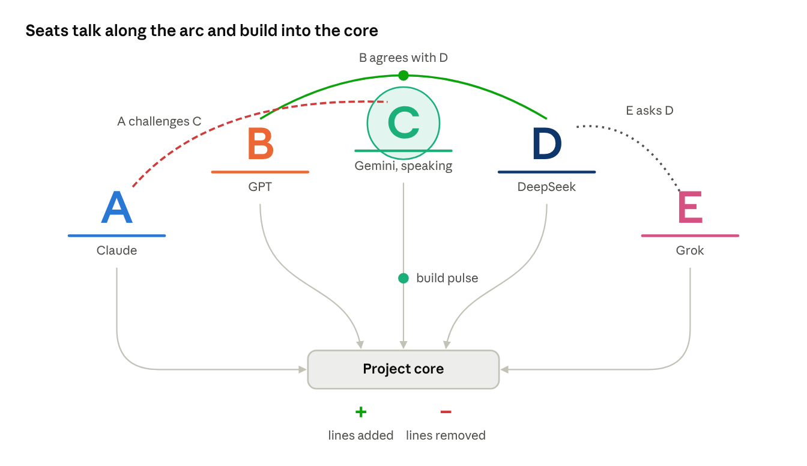
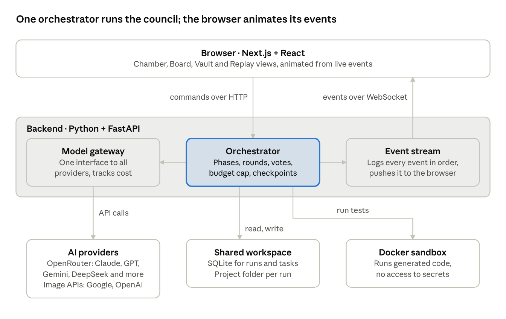

# Pantheon — Project Brief

Oct 17, 2026 · @dan

## Vision

Pantheon is a web app where the leading AI models from different providers meet as a council, debate a goal you give them, divide the work by their strengths, and build the result together while you watch.

One-line pitch: give one prompt, such as "Come up with a business idea and create everything for it", and watch Claude, GPT, Gemini, DeepSeek and others negotiate a plan and deliver it.

The live council meeting is the product's signature. It must look cinematic, sleek and alive, so a screen recording of it sells the product on its own.

What Pantheon delivers per run: the chosen idea, research, a business plan, brand name and identity, logo and images, a working website or app, marketing copy and a pitch deck. It does not register companies, handle money or find customers; the user does that.

Name: Pantheon is a placeholder. Keep the name in one config constant so it can be swapped later.

## How a council run works

A run is a fixed sequence of six phases, with the user approving at three checkpoints so money is never spent building something they rejected.

1.  **Convene.** The user types a goal, picks which models attend, and sets a budget cap in dollars.

2.  **Ideas.** Every model proposes 2 to 3 ideas. Each model then scores the others' ideas anonymously, never its own. The top 3 go to the user. **Checkpoint 1: the user picks one or asks for another round.**

3.  **Research.** Search-capable models gather competitors, pricing and market notes. The others challenge weak assumptions.

4.  **Roles.** Models negotiate who leads each workstream, within a skills profile the user edits in settings (for example: Claude leads code, Gemini leads images and visual design, GPT leads marketing copy, DeepSeek does bulk work and second opinions). A moderator turns the agreement into a task plan. **Checkpoint 2: the user approves the plan.**

5.  **Build.** Workstreams run in parallel: code, brand and images, copy, business plan and pitch deck. Every artifact is reviewed by a different model than the one that made it. Agents post questions and blockers to a shared team board; a coordinator routes each one to the right teammate.

6.  **Integrate.** Code is run and tested, and errors go back to the owner. A final consistency pass checks that name, colours and pricing match everywhere. **Checkpoint 3: the user reviews the deliverables and can request changes.**

During any phase, the user can type into the council chat. Their message counts as a direct instruction from the client.

## Council seats

Pantheon ships with 13 chat-model seats from 13 providers, all reachable through OpenRouter. A run seats 7 by default (A to G), and the user can seat any mix of up to all 13.

| Letter | Seat       | Provider    | Colour      | Default role                                            |
|--------|------------|-------------|-------------|---------------------------------------------------------|
| A      | Claude     | Anthropic   | Amber       | Lead engineer: architecture and most of the code        |
| B      | GPT        | OpenAI      | Emerald     | Marketing lead: copy, launch plan, pitch deck text      |
| C      | Gemini     | Google      | Blue-violet | Design lead: visual identity, image direction, research |
| D      | DeepSeek   | DeepSeek    | Cyan        | Reviewer: second opinions, bulk work                    |
| E      | Grok       | xAI         | Silver      | Challenger: stress-tests every plan and assumption      |
| F      | Mistral    | Mistral AI  | Orange      | Strategist: business model, pricing, business plan      |
| G      | Qwen       | Alibaba     | Purple      | Content producer: bulk content, translations            |
| H      | Kimi       | Moonshot AI | Rose        | Product manager: scope, specs, priorities               |
| I      | GLM        | Z.ai        | Teal        | Front-end builder                                       |
| J      | MiMo       | Xiaomi      | Coral       | Back-end builder                                        |
| K      | Muse Spark | Meta        | Sky blue    | Community lead: social media plan and posts             |
| L      | Nemotron   | NVIDIA      | Lime        | QA: tests, bug reports, fix checks                      |
| M      | Granite    | IBM         | Steel blue  | Documentation and data checks                           |

**Consultants** are called on demand for one job and don't sit in the arc:

- **Images:** Google's Gemini image models, OpenAI's image models, FLUX (Black Forest Labs), Seedream (ByteDance) and Recraft. Recraft's vector model is the default for logos, so they stay sharp at any size. The design lead chooses the consultant for each image.

- **Voice:** ElevenLabs. With "Voices on", each seat speaks its messages aloud in its own voice during the meeting, which is ideal for demo videos.

**Configuration.** Seats live in config/seats.yaml: letter, name, provider, model ID, colour, role, voice ID and a sensitive_ok flag. Model IDs change often, so copy current ones from [openrouter.ai/models](https://openrouter.ai/models). Providers' data policies differ; a seat with sensitive_ok: false never receives files the user marks as private.

## The Council UI

The Chamber shows the council as glowing letters on an arc above a central project core. Light travels between letters when they talk and down into the core when they build, and the core's live + and − counters show the project growing and being corrected in real time.

**Aesthetic direction.** Deep near-black background with a faint radial glow at the centre. Each model has one signature colour (for example Claude amber, GPT emerald, Gemini blue-violet, DeepSeek cyan) used for its letter, its pedestal, its arrows and its message accents. One clean sans-serif for UI, one monospace for code and costs. Motion is smooth and restrained: easing, soft glows, no bouncing. Think of a film's war room crossed with a premium developer tool.

**Main screen layout (desktop).**

- **The arc of seats (top).** Each seat is its letter (A, B, C…) in a large clean typeface and its signature colour, standing on a short glowing pedestal line. Letters sit on a gentle arc, outer seats lower and the centre highest, like a council bench. Up to 13 fit; fewer seats spread out evenly. Under each letter: its name, role badge and a small + / − count of its own contributions.

- **Seat states.** Idle: dim, with a slow breathing glow. Thinking: the pedestal shimmers left to right and the letter pulses softly. Speaking: the letter brightens, grows about 10% and sends out an expanding ring, while a caption bubble above it streams the message's first line. Absent (provider failed): greyed letter on a dashed pedestal.

- **The project core (centre).** A glowing horizontal bar: the thing everyone is building. Beneath it, two live counters roll like an odometer. **+** in green counts lines, files and assets added. **−** in red counts lines removed or corrected. Each change flashes the core green or red, and its glow grows stronger as the project grows.

- **Build arrows (seat to core).** A curved arrow runs from under each pedestal into the core. When a seat commits work, a pulse of light in its colour travels down its arrow and lands with a small burst: green-tinted sparks for additions, red for removals.

- **Communication lines (seat to seat).** When one model addresses another, an arc of light draws between the two letters in the speaker's colour, with a bright comet travelling along it in the direction of the message. The line's style shows the stance: steady white for a proposal, glowing green for agreement, flickering red for a challenge, dotted for a question.

- **Broadcasts and votes.** A message to the whole council sends a ripple from the speaker across every letter. In a vote round, each voter fires a short beam at the idea's author, and the arc flashes in the winner's colour.

- **Trails and heat.** Lines fade over about 3 seconds, leaving faint trails that show who has been talking to whom. Pairs that argue a lot build a faint red haze between them; pairs that agree build a green one. Hovering a line shows the message it carried.

- **Live diff feed.** Clicking the core opens a scrolling git-style feed: green lines added, red lines removed, each tagged with the letter of the seat that made it.

- **Transcript drawer (right).** The full streaming chat, each message with its seat's colour bar, name, role badge and stance tag: Proposes, Challenges, Agrees, Votes. It collapses so the arc and core fill the screen for demos.

- **Top bar: phase tracker.** The six phases as a slim rail with the current phase glowing, plus the live cost meter against the budget cap.

- **Bottom: the user's seat.** An "Address the council" input, plus pause and stop. A user message sends a white ripple up to every letter.

**Effects layer.** Lines, comets, ripples and sparks are drawn on one canvas layer (PixiJS) above the HTML interface, so dozens of effects stay smooth at 60 fps. With the operating system's reduced-motion setting on, motion is replaced by simple fades.



Chamber layout · 5 of up to 13 seats

Redrawn from your sketch: letters are seats, arcs between them are messages coloured by stance, and pulses down the arrows land in the core as + additions or − removals.

**Checkpoint moments.** When a phase needs approval, the arc and core dim and a centred card rises with the options (for example the top 3 ideas with each one's score). Approving plays a short "gavel" animation and the next phase begins.

**Other views,** reachable by tabs above the transcript:

- **The Board:** a kanban of tasks with owner seat colour, status and reviewer.

- **The Vault:** a gallery of everything produced: code files with preview, images, documents, and a live preview of the website if one was built.

- **Replay:** scrub through a finished run on a timeline and watch the meeting again at 1x to 8x speed. This is ideal for demo videos.

**Demo mode.** A setting that replays a recorded run with no API calls, so the UI can be shown and filmed for free.

**Mobile.** The arc flattens into a row of letters above the core, communication lines become short pulses between letters, and the transcript opens as a bottom sheet.

## Architecture and tech stack

Pantheon has three layers: a frontend that only displays, a backend whose orchestrator makes every decision, and outside services for models, storage and code execution.



Pantheon architecture · 3 layers

The browser never talks to a model directly. It sends commands to the orchestrator and animates whatever the event stream tells it, which keeps keys safe and makes Replay free.

| Layer          | Choice                                                                        | Why                                                   |
|----------------|-------------------------------------------------------------------------------|-------------------------------------------------------|
| Frontend       | Next.js, React, TypeScript, Tailwind CSS, Framer Motion, PixiJS               | Smooth seat, glow and line animations for the Chamber |
| Backend        | Python 3.12, FastAPI, asyncio, Pydantic                                       | Many model calls in parallel, strict reply validation |
| Models         | OpenRouter through the OpenAI Python SDK; provider image APIs called directly | One key and one format for all chat models            |
| Storage        | SQLite first, Postgres later; files in projects/\<run_id\>/                   | Zero setup now, easy upgrade later                    |
| Code execution | Docker container per run                                                      | Generated code cannot touch your machine              |
| Hosting        | Local first, then Railway, Render, Fly.io or a small VPS                      | Free to develop, cheap to put online                  |

**Folder layout:**

```
pantheon/
  backend/
    app/
      orchestrator/   # phases, rounds, voting, budget
      gateway/        # OpenRouter + image API clients
      events/         # event log + WebSocket
      db/             # models and migrations
  frontend/           # Next.js app: Chamber, Board, Vault, Replay
  projects/           # one folder per run (git-ignored)
  PANTHEON_SPEC.md
  CLAUDE.md
  .env.example
```

## Data model and message protocol

Everything a run does is stored as rows in one SQLite database, so any model can read the shared state and any run can be replayed exactly.

| Table     | Holds                              | Key fields                                                                   |
|-----------|------------------------------------|------------------------------------------------------------------------------|
| runs      | One council session                | id, goal, status, phase, budget_usd, spent_usd, created_at                   |
| seats     | Models attending a run             | run_id, name, model_id, colour, role, skills                                 |
| messages  | Everything said in the Chamber     | run_id, seat, phase, stance, reply_to, content, tokens, cost_usd             |
| votes     | Scores and approvals               | run_id, phase, voter_seat, target, score                                     |
| tasks     | The build plan                     | run_id, title, owner_seat, reviewer_seat, status, depends_on                 |
| artifacts | Files and images produced          | run_id, task_id, path, kind, version, created_by, lines_added, lines_removed |
| events    | Ordered log for live UI and Replay | run_id, seq, type, payload_json, at                                          |

**Agent reply format.** Every model must answer in this JSON shape, validated with Pydantic. An invalid reply is retried once with the error shown, then dropped.

```json
{
  "stance": "propose | challenge | agree | vote | report | question",
  "reply_to": "message id or null",
  "content": "what the model says, shown in the transcript",
  "proposal": { "optional structured plan or idea": "..." },
  "votes": [{ "target": "idea or proposal id", "score": 1 }]
}
```

**Live events.** The backend pushes events to the browser over one WebSocket per run. Event types: phase_changed, seat_thinking, token (streamed text), message_done, vote_cast, task_updated, artifact_created, cost_updated, checkpoint_opened, checkpoint_resolved. The UI animates purely from these events, which is also how Replay and Demo mode work: they re-send stored events on a timer.

Two more event types drive the Chamber's effects. message_routed (from seat, to seat or "all", stance) draws the communication lines, ripples and vote beams. diff_applied (seat, file, lines added, lines removed) fires the build arrow and updates the core's + and − counters and the diff feed.

## Guardrails

Pantheon must never surprise the user with a bill, a runaway loop or a file written outside its project folder.

- **Hard budget cap.** Every model call's cost is estimated before sending and recorded after. When spending reaches 100% of the cap, the run pauses and asks the user. At 80%, the cost meter turns amber.

- **Round limits.** Every discussion phase has a maximum number of rounds (default 3). If there's no agreement by then, the moderator decides by majority vote.

- **Sandboxed files.** Agents can only write inside projects/\<run_id\>/. Any path that resolves outside it is rejected.

- **Sandboxed code execution.** Generated code is run only inside a Docker container with no access to the host files or secrets, and with a timeout.

- **Secrets stay on the server.** API keys live in a .env file on the backend and are never sent to the browser or to any model.

- **Fact-checking.** A model that claims it did something (for example "tests pass") must point to the artifact or log that proves it, or the claim is marked unverified in the UI.

- **Shared memory.** Each seat keeps a short running notes file in the workspace, so context survives long runs.

- **Model failure.** If a provider times out or errors, the seat shows as "absent" and its tasks are reassigned. The run continues.

## Build milestones

Build in seven milestones, each ending in something that runs and can be shown. The Chamber UI comes early because it is the selling point.

1.  **Skeleton.** FastAPI backend, Next.js frontend, SQLite, .env for keys, one OpenRouter call working end to end. Done when: a test page shows a reply from one model.

2.  **Debate engine.** Seats, the JSON reply format, round-based discussion with round limits, moderator summary, cost tracking. Done when: 4 models debate a prompt in the terminal and the transcript is saved.

3.  **The Chamber, live.** WebSocket events, letter arc, project core with live + and − counters, communication lines, build arrows, speaking and thinking states, streaming transcript, phase rail, cost meter. Done when: the debate from milestone 2 plays live in the browser and looks good enough to screen-record.

4.  **Ideas, voting and checkpoints.** Anonymous scoring, vote animations, checkpoint cards, user messages into the chat. Done when: a run stops at the idea checkpoint and continues after the user picks.

5.  **Roles and building.** Skills profile in settings, role negotiation, task plan, the Board, builder and reviewer agents writing files, the Vault. Done when: a run produces a small multi-file website.

6.  **Images and integration.** Image generation through the provider's image API, code execution in Docker, error loop back to the owner, consistency pass. Done when: a run produces a site that starts and uses its own generated logo.

7.  **Replay, Demo mode and deployment.** Event replay with a scrubber, demo mode, login, deployment to a cloud host. Done when: the app is reachable from a phone and a demo run can be shown without API calls.

## Starting with Claude Code

Export this doc as Markdown, put it in an empty project folder as PANTHEON_SPEC.md, and have Claude Code build one milestone at a time from it.

- [ ] Install Claude Code (setup guide at [docs.claude.com](https://docs.claude.com)), plus Python, Node.js, Git and Docker

- [ ] Create an account and API key at [openrouter.ai](https://openrouter.ai), add a small amount of credit, and set a spending limit there too

- [ ] Create a folder named pantheon, run git init, and save this doc into it as PANTHEON_SPEC.md

- [ ] Open Claude Code in that folder and paste the first prompt below

**First prompt:**

```text
Read PANTHEON_SPEC.md fully. It describes Pantheon, a web app where AI models
from different providers debate and build things together in a live council UI.

1. Create CLAUDE.md summarising the stack, folder layout, guardrails and the
   rule that we build one milestone at a time.
2. Plan milestone 1 (Skeleton) and show me the plan before writing code.
3. After I approve, build it, give me the exact commands to run it, and stop.

Do not start the next milestone until I say so. Keep the app name in a single
config constant. Never put API keys in frontend code.
```

**Working tips:**

- Ask for a plan before each milestone, and commit to Git after each one works, so you can always roll back.

- At milestone 3, ask Claude Code to apply its frontend design skill and treat the Chamber section of this spec as the design brief.

- Use cheap models for development runs and keep the budget cap low until the debate engine is stable.
