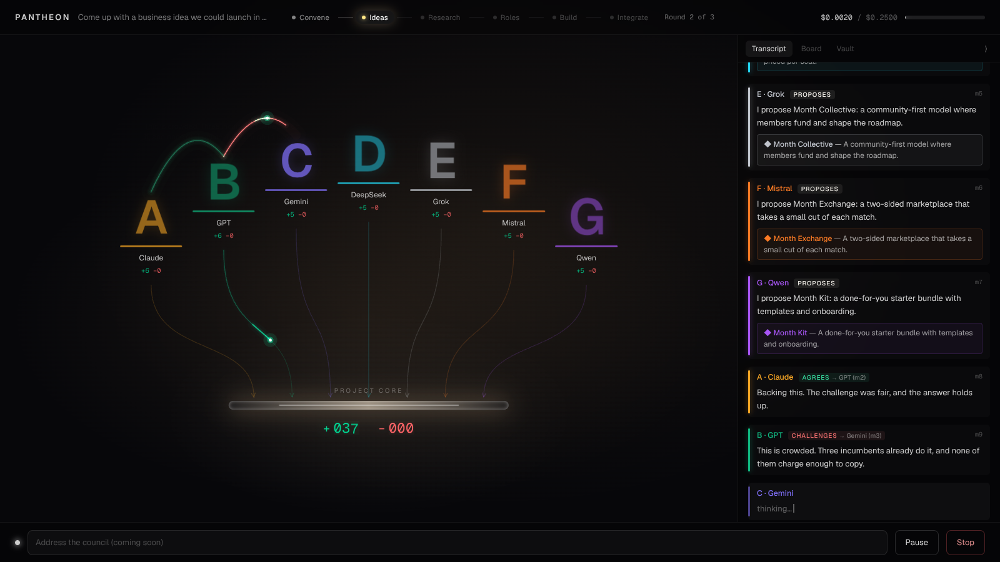

# Pantheon

A council of AI models from different providers debates your goal, splits the work and builds the result while you watch. The full spec is in [`PANTHEON_SPEC.md`](PANTHEON_SPEC.md). "Pantheon" is a placeholder name; it lives in `backend/app/config.py` (`APP_NAME`) and `frontend/src/lib/app.ts`.

## Status

- Milestone 1 (Skeleton) is done: FastAPI, Next.js and SQLite, with one OpenRouter call going end to end.
- Milestone 2 (Debate engine) is done: seats debate a goal in the terminal with round limits, a majority vote, a moderator summary and a hard budget cap, and the transcript is saved.
- Milestone 3 (The Chamber, live) is done: convene a council in the browser and watch the debate play out live.

No seat has a fixed role. Later in a run, each model puts itself forward for the work it's best at and the council votes on who does what.



## Requirements

Python 3.12, [uv](https://docs.astral.sh/uv/), Node.js 20+ and an [OpenRouter](https://openrouter.ai) key. Set a spending limit on the key.

## Run it

```bash
cp .env.example .env          # then put your key in OPENROUTER_API_KEY

# Terminal 1: backend on :8000
cd backend
uv sync
uv run uvicorn app.main:app --reload --port 8000

# Terminal 2: frontend on :3000
cd frontend
npm install
npm run dev
```

Open http://localhost:3000, write a goal, pick the seats, set a budget cap and press **Convene the council**. The Chamber opens and the debate plays live. http://localhost:3000/test still sends a single test call.

### Practice without spending anything

`backend/scripts/fake_openrouter.py` stands in for OpenRouter and streams scripted debates. Use it to work on the UI or film the Chamber for free:

```bash
# Terminal 1: the practice server
cd backend && uv run python scripts/fake_openrouter.py          # --cps 80 types slower

# Terminal 2: the backend, pointed at it
cd backend && OPENROUTER_BASE_URL=http://127.0.0.1:9100/v1 OPENROUTER_API_KEY=fake \
  uv run uvicorn app.main:app --reload --port 8000

# Terminal 3: the frontend as usual
cd frontend && npm run dev
```

`--fail anthropic/claude-sonnet-4.5` makes that seat's provider fail, so you can see the absent state.

### The Chamber

- **Arc of seats:** each seat's letter in its colour on a pedestal. A seat dims when idle, shimmers while thinking, and grows with a caption bubble while speaking. A seat whose provider failed turns grey on a dashed pedestal.
- **Lines between seats:** white for a proposal, green for agreement, flickering red for a challenge, dotted for a question. A comet travels in the speaker's colour, and the line fades to a faint trail. Pairs that argue or agree build red or green haze between them. Hover a line to see the message it carried.
- **Project core:** every file a seat writes sends a pulse down its arrow into the core. The odometer counters show lines added and removed. Click the core for the live diff feed. In this milestone the files are each seat's proposal and notes in `projects/<run_id>/`.
- **Top bar:** the phase rail and the cost meter, which turns amber at 80%. At the cap, the run pauses and a card asks you to raise it or stop.
- **Transcript drawer:** streams every message. It collapses for demos, and on phones it becomes a bottom sheet.
- **Pause and stop** take effect between turns. Reduced-motion settings swap the effects for simple fades.
- Opening a run's link later replays the whole meeting from the event log, then continues live.

## Run a debate in the terminal

```bash
cd backend
uv run python -m app.cli debate "Come up with a name and positioning for a coffee subscription startup" \
  --seats A,B,C,D --rounds 3 --budget 0.25
```

- Round 1: every seat proposes. Rounds 2 and 3: seats agree, challenge, propose or question. If every present seat agrees with the same proposal, the debate ends early.
- After the round limit, each seat votes for one proposal that isn't its own and the majority wins. The moderator (`MODERATOR_MODEL`) breaks ties and writes the summary.
- Each call's cost is estimated before it's sent, using OpenRouter's price list, and the real cost is recorded after. At 80% of the cap you get an amber warning. If a call would pass the cap, the run pauses and asks for a new cap, or stops if you press Enter.
- A seat whose provider fails shows as absent and the debate continues. An invalid reply is retried once with the error shown, then dropped.
- The transcript is saved to `projects/<run_id>/transcript.md` and `transcript.json`. Every step is also stored in the `events` table for the live Chamber and Replay later.
- For the cheapest test run, add `--model-override openai/gpt-4o-mini` so every seat uses one cheap model.

The model IDs in `config/seats.yaml` change often. Check them at https://openrouter.ai/models before a real run.

## Checks

```bash
cd backend && uv run pytest        # mocked gateway, no API cost
cd frontend && npm run lint && npm run build
```

## Layout

```
backend/app/config.py      APP_NAME + settings from .env
backend/app/gateway/       OpenRouter client (OpenAI SDK)
backend/app/db/            SQLite tables: runs, seats, messages, votes, tasks, artifacts, events
backend/app/orchestrator/  debate rounds, voting, budget, reply format, file sandbox
backend/app/events/        ordered event log + in-process bus for the WebSocket
backend/app/runs.py        starts runs in the background; pause, stop, budget answers
backend/app/cli.py         terminal entry point
backend/scripts/           fake_openrouter.py practice server
frontend/                  Next.js app; /api/* is proxied to the backend, the WebSocket goes direct
frontend/src/lib/chamber/  event reducer, layout geometry, WebSocket hook
frontend/src/components/   Chamber (seats, core, PixiJS effects, transcript) and the convene form
config/seats.yaml          the 13 seats (check model IDs at openrouter.ai/models)
projects/                  one folder per run (git-ignored)
```
