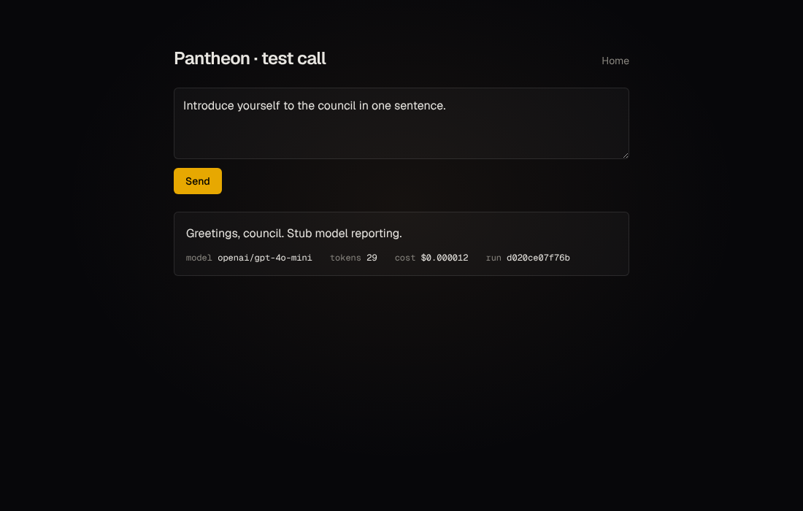

# Pantheon

A council of AI models from different providers debates your goal, splits the work and builds the result while you watch. The full spec is in [`PANTHEON_SPEC.md`](PANTHEON_SPEC.md). "Pantheon" is a placeholder name; it lives in `backend/app/config.py` (`APP_NAME`) and `frontend/src/lib/app.ts`.

## Status

Milestone 1 (Skeleton) is done: FastAPI, Next.js and SQLite, with one OpenRouter call going end to end.



## Requirements

Python 3.12, [uv](https://docs.astral.sh/uv/), Node.js 20+ and an [OpenRouter](https://openrouter.ai) key. Set a spending limit on the key.

## Run it

```bash
cp .env.example .env          # then put your key in OPENROUTER_API_KEY

# Terminal 1: backend on :8000
cd backend
uv sync
uv run uvicorn app.main:app --reload --port 8000

# Terminal 2: frontend on :3000
cd frontend
npm install
npm run dev
```

Open http://localhost:3000/test and press **Send**. The reply, the token count and the cost appear under the box. Each call is saved as a run plus a message in `pantheon.db`.

## Checks

```bash
cd backend && uv run pytest        # mocked gateway, no API cost
cd frontend && npm run lint && npm run build
```

## Layout

```
backend/app/config.py      APP_NAME + settings from .env
backend/app/gateway/       OpenRouter client (OpenAI SDK)
backend/app/db/            SQLite tables: runs, seats, messages, votes, tasks, artifacts, events
backend/app/orchestrator/  (milestone 2)
backend/app/events/        (milestone 3)
frontend/                  Next.js app; /api/* is proxied to the backend
config/seats.yaml          the 13 seats (check model IDs at openrouter.ai/models)
projects/                  one folder per run (git-ignored)
```
