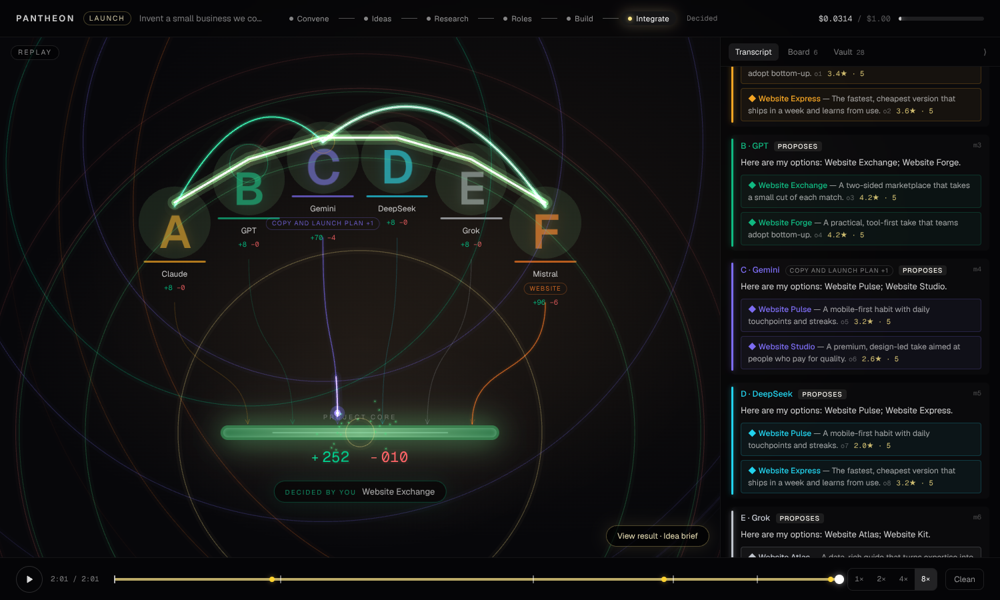
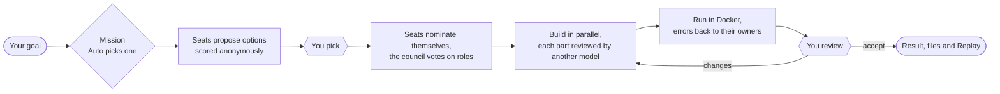
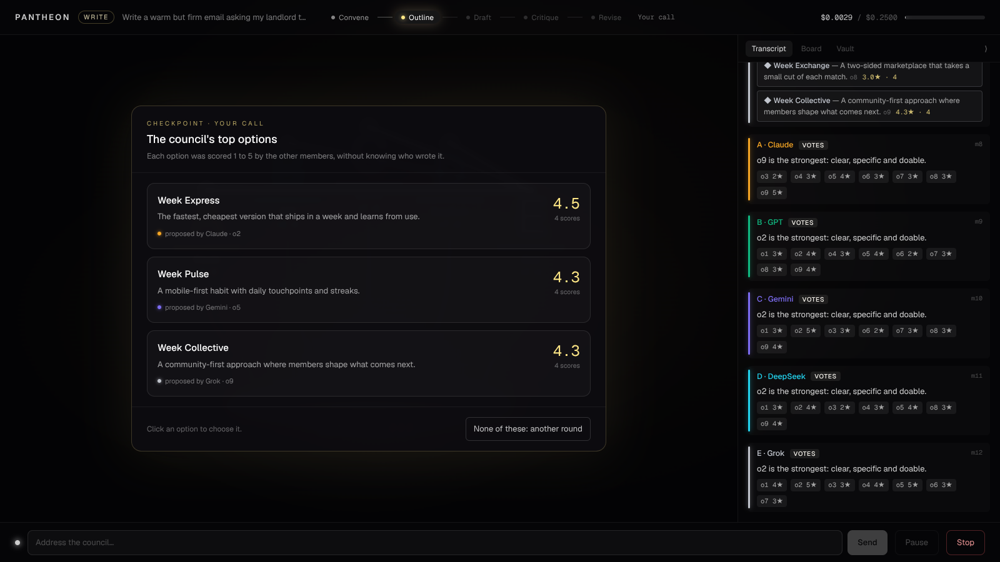
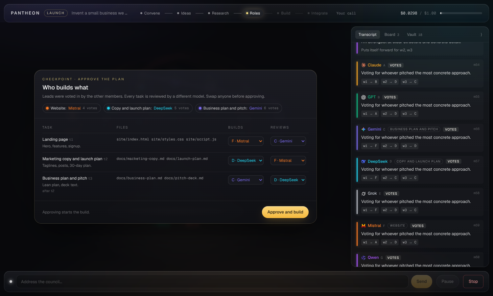
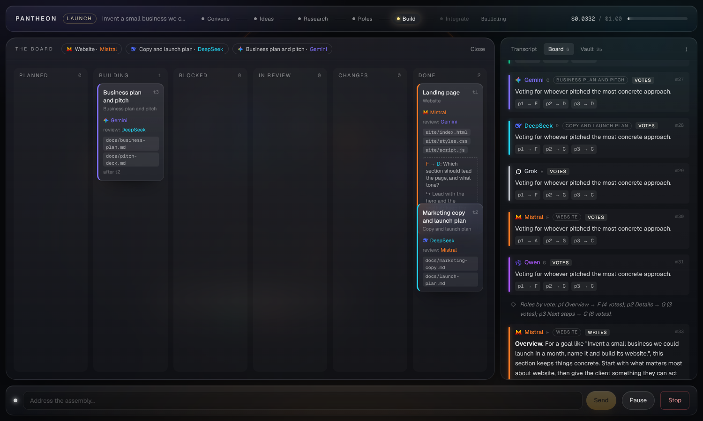
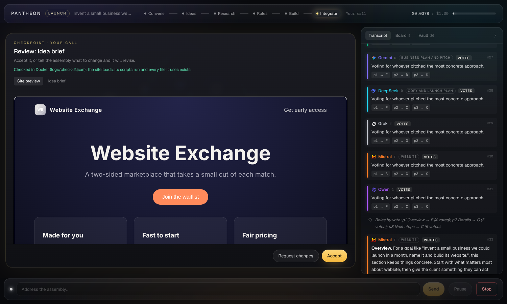
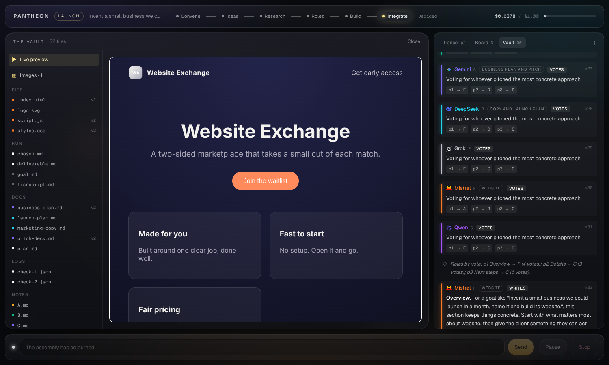
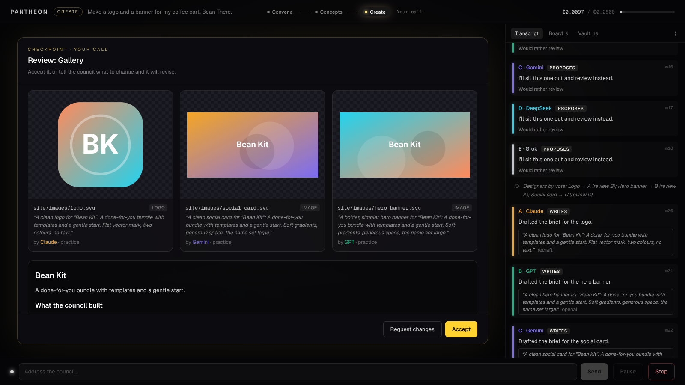
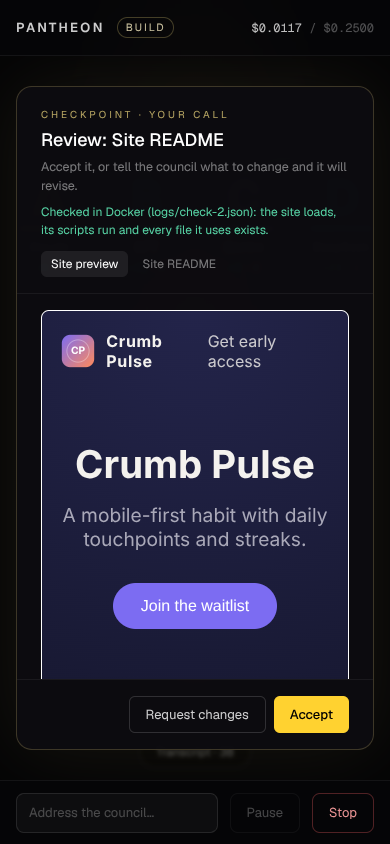

<div align="center">


# Pantheon

**A council of AI models from different providers that debates your goal, votes on who does what, and builds the result while you watch.**


[](LICENSE)

[Quick start](#quick-start) · [Try it for free](#try-it-without-spending-anything) · [Deploy](docs/DEPLOY.md) · [Full spec](PANTHEON_SPEC.md)

<br>



</div>

## What it is

You give it a goal: a question, an email to write, a trip to plan, a decision, a topic to learn, a website or a whole business idea. Claude, GPT, Gemini, DeepSeek, Grok, Mistral and up to seven more models sit as a council in the **Chamber**, a live view where you watch them work:

- **They debate.** Each model proposes, challenges and agrees in the open. Options are scored anonymously, so no model knows whose idea it's rating.
- **They vote on roles.** No model has a fixed job. Each one puts itself forward for the part it's best at, and the others vote. Nobody can vote for themselves.
- **They build.** Builders write real files in parallel, a different model reviews each part, the site runs in a locked-down Docker container, and any errors go back to whoever wrote that file.
- **You stay in charge.** You pick between the top options, approve the plan, review the result, and can message the council at any time. A hard budget cap pauses the run before it overspends.

## How a run works



Each run has a **mission** that sets its phases and what it delivers. You decide at the steps in bold:

| Mission | For | Phases |
|---|---|---|
| **Ask** | Questions and advice | Answer → Debate → Verdict |
| **Write** | Emails, essays, cover letters, posts | **Outline** → Draft → Critique → **Revise** |
| **Plan** | Trips, events, meals, workouts | **Options** → Detail → **Check** |
| **Decide** | Choosing between products or offers | Criteria → Research → Debate → **Recommendation** |
| **Learn** | Understanding a topic | **Approach** → Lesson → Quiz |
| **Build** | Websites and small web apps | **Ideas** → **Roles** → Build → Integrate → **Review** |
| **Create** | Logos, illustrations, image sets | **Concepts** → Create → **Review** the gallery |
| **Launch** | A business from scratch | **Ideas** → Research → **Roles** → Build → Integrate → **Review** |

Leave it on **Auto** and the moderator reads your goal, picks the mission and says why.

## Screenshots

<table>
  <tr>
    <td width="50%"><br><sub><b>Pick.</b> The council's top options, scored anonymously. You choose.</sub></td>
    <td width="50%"><br><sub><b>Plan.</b> Roles were voted in. Change any owner or reviewer, then approve.</sub></td>
  </tr>
  <tr>
    <td><br><sub><b>The Board.</b> Every task, its owner and reviewer, as it moves through the build.</sub></td>
    <td><br><sub><b>Review.</b> The site itself, checked in Docker. A claim of success without proof is tagged <i>Unverified</i>.</sub></td>
  </tr>
  <tr>
    <td><br><sub><b>The Vault.</b> Every file the run wrote, plus a sandboxed live preview of the site.</sub></td>
    <td><br><sub><b>Create.</b> Images made by the image providers, each with its prompt and who asked for it.</sub></td>
  </tr>
</table>

<p align="center"><br><sub>It works on phones too: the transcript becomes a bottom sheet.</sub></p>

<sub>These screenshots were taken with the built-in practice council, so the replies are scripted. Model logos are trademarks of their owners, shown only to identify each model; no affiliation or endorsement is implied. The logo files come from <a href="https://github.com/lobehub/lobe-icons">Lobe Icons</a> (MIT).</sub>

## Quick start

You need Python 3.12 with [uv](https://docs.astral.sh/uv/), Node.js 20+, and an [OpenRouter](https://openrouter.ai) key with a spending limit set. [Docker](https://docs.docker.com/get-docker/) is optional; it's only used to run the sites that Build and Launch make.

```bash
git clone https://github.com/el1tino/pantheon.git && cd pantheon
cp .env.example .env    # fill in OPENROUTER_API_KEY, ADMIN_EMAIL and ADMIN_PASSWORD (10+ characters)

# Optional: the sandbox image for running generated sites
docker build -t pantheon-runner:1 backend/runner

# Terminal 1: the backend on :8000
cd backend && uv sync && uv run uvicorn app.main:app --reload --port 8000

# Terminal 2: the frontend on :3000
cd frontend && npm install && npm run dev
```

**On Windows, the easy way:** after installing the tools, double-click **`start.bat`** in the `pantheon` folder. The first time, it opens Notepad so you can fill in `.env`. It then installs everything, starts the backend and the frontend in their own windows, and opens the browser. It keeps checking GitHub every minute and applies updates by itself: code changes reload on their own, and the servers restart when new packages arrive. To stop, close the three windows. (The script is `scripts/start.ps1`; it also runs in PowerShell 7 on a Mac.)

Open **http://localhost:3000** and log in with your `ADMIN_EMAIL` account, which is created on first start. Pick a mission (or leave it on Auto), write a goal, choose the seats and a budget cap, and press **Convene the council**.

> [!TIP]
> Keep **One cheap model for every seat** ticked and the budget low while you try it out. The model IDs in `config/seats.yaml` change often, so check them at [openrouter.ai/models](https://openrouter.ai/models) before a real run.

### Try it without spending anything

**Watch the demo.** The repo ships with a recorded Launch run with six seats. Open **Watch a demo** on the login page; no account or API key is needed. In the recording, the council picks an idea, votes on roles and builds a site. The first Docker check catches a bug, and the second passes after the builder fixes it.

**Run the practice council.** `backend/scripts/fake_openrouter.py` stands in for OpenRouter and streams scripted replies for every mission, so you can drive the whole app for free:

```bash
cd backend && uv run python scripts/fake_openrouter.py                         # terminal 1
cd backend && OPENROUTER_BASE_URL=http://127.0.0.1:9100/v1 OPENROUTER_API_KEY=fake \
  uv run uvicorn app.main:app --reload --port 8000                            # terminal 2
cd frontend && npm run dev                                                    # terminal 3
```

`--cps 80` makes the replies type more slowly. `--fail <model id>` makes that model fail, so you can see how the council carries on without it.

## Deploy

One VPS, Docker Compose, and Caddy for automatic HTTPS:

```bash
cp .env.example .env    # set DOMAIN, DOCKER_GID, OPENROUTER_API_KEY, ADMIN_EMAIL, ADMIN_PASSWORD
docker compose up -d --build
```

[`docs/DEPLOY.md`](docs/DEPLOY.md) covers the server setup, updates, backups and the security notes. For a public link that costs nothing, run a copy with `DEMO_MODE=true`: new runs are switched off and visitors can only watch the recorded demo.

## Built-in safeguards

| | |
|---|---|
| **Hard budget cap** | Each call's cost is estimated before it's sent and recorded after. The meter turns amber at 80%. At 100%, the run pauses and asks you. |
| **Sandboxed code** | Generated sites run only in a fresh Docker container per check, with no network, a read-only filesystem, no secrets, no Linux capabilities, a non-root user, memory, CPU and process limits, and a 30-second timeout. |
| **Sandboxed files** | Models can only write text files under `site/` or `docs/` in their run's folder. Any path that leads outside is rejected. Generated SVG is cleaned with an allowlist. |
| **Secrets stay on the server** | API keys live only in the backend's `.env`. The browser never calls a model, and keys are never shown to any model. |
| **Proof, not claims** | A message that says "it works now" has to point to a passing check log. Otherwise it is tagged *Unverified*. |
| **Private accounts** | Sign-up is by invite only, with Argon2 passwords and HttpOnly session cookies. Each person sees only their own runs. |
| **Model failure** | If a provider fails, its seat shows as absent, its work goes to another seat, and the run carries on. |
| **Round limits** | Each discussion gets at most 3 rounds. Without agreement by then, a majority vote decides. |

## Inside a run

<details>
<summary><b>The Chamber</b>: what you're looking at</summary>

- **Arc of seats:** each model is its provider's logo on a glass disc that glows in the seat's colour, with its seat letter beside it. A seat dims when idle, shimmers while thinking, and grows with a caption bubble while speaking. A seat whose provider failed turns grey.
- **Lines between seats:** an arc grows from the speaker's disc to the listener's with a comet at its tip, lands with a soft ring, then draws itself into the listener and leaves a faint trail. White for a proposal, green for agreement, red (gently pulsing) for a challenge, dotted for a question. Votes are quick low arcs. Pairs that keep arguing or agreeing build up red or green haze. Hover a line to see the message it carried.
- **Project core:** every file a seat writes sends a pulse into the core, and the counters show lines added and removed. Click the core for the live diff feed.
- **Top bar:** the mission's phase rail and the cost meter.
- **Transcript, Board and Vault:** the drawer on the right holds every message, the task board and every file. On phones it becomes a bottom sheet.
- **Your seat:** the bar at the bottom. Message the council at any time, or pause or stop the run. Reduced-motion settings swap the effects for simple fades.

</details>

<details>
<summary><b>Options, voting and roles</b></summary>

- **Options:** every seat proposes 1 to 3 options, and the others score them 1 to 5 without knowing who wrote them. You pick from the top 3, or ask for another round.
- **Roles:** the moderator splits the work into parts or workstreams. Seats pitch for them, the others vote (never for themselves), and the moderator breaks ties. Each seat's badge shows the part it won.
- **Critique and revise:** reviewers have to point at a specific passage in someone else's part, and the owner revises it.
- **Your messages** reach every seat as a direct instruction from the client.
- **Health, legal and money questions:** the council says it isn't a professional and flags when you should see one.

</details>

<details>
<summary><b>Building</b> (Build and Launch)</summary>

- The moderator turns the voted roles into a task plan. Every task has an owner, a reviewer who is always a different model, files and dependencies. You approve the plan and can reassign anything first.
- Tasks run in waves that respect their dependencies, up to 3 at a time. A builder can ask a teammate one question through the Board.
- Each reviewer approves or asks for specific changes, with at most 2 rounds. If you ask for changes at the review, they go to the tasks they affect.
- Builders reply in the usual JSON, followed by `=== FILE: path ===` … `=== END FILE ===` blocks.
- Launch also writes marketing copy, a launch plan, a business plan and pitch-deck text.
- The preview in the Vault is served with a strict Content Security Policy inside a sandboxed iframe, from a hard-to-guess per-run URL. Its scripts can't reach the app or the internet.

</details>

<details>
<summary><b>Images and integration</b></summary>

- **Image providers:** Recraft (vector, the default for logos), OpenAI, Gemini, FLUX and Seedream. Each one is available only when its key is in `.env`, and that key goes only to its own provider. With no keys, a free practice provider draws simple SVGs on your machine. Every image counts against the budget cap.
- **Create:** seats are voted in as designers for each image, a different seat reviews each brief, a challenged image is regenerated once, and you review the gallery.
- **Integrate:** the checker in `backend/runner/` loads every page with jsdom, runs its scripts, and reports script errors, missing files and a missing logo. Each error goes back to the owner of its file, with at most 2 fix loops. A consistency pass then checks that the name, colours and prices match across the site and the documents. Check logs are kept as `logs/check-N.json`.

</details>

<details>
<summary><b>Replay and the demo</b></summary>

- Every finished run has a **Replay** button. It plays the stored events back through the same Chamber at 1×, 2×, 4× or 8×, with long waits cut short.
- The scrubber marks each phase and checkpoint. Drag it, or use the arrow keys and the space bar.
- **Clean** hides the transcript and controls, for filming.
- Turn a finished run into a demo with `uv run python -m app.cli export-demo RUN_ID SLUG`. That writes `demo/SLUG/`, which every server imports on start as a public, read-only run.

</details>

<details>
<summary><b>Accounts</b></summary>

The owner account comes from `ADMIN_EMAIL` and `ADMIN_PASSWORD` on first start. The owner presses **Invite someone** to get a one-use link that expires after 7 days. You can also add accounts from the terminal:

```bash
cd backend && uv run python -m app.cli create-user friend@example.com   # --owner for another owner
```

</details>

<details>
<summary><b>A debate in the terminal</b></summary>

```bash
cd backend
uv run python -m app.cli debate "Name and position a coffee subscription startup" \
  --seats A,B,C,D --rounds 3 --budget 0.25 --model-override openai/gpt-4o-mini
```

Seats propose, then agree, challenge or question for up to 3 rounds. If they don't all agree, a majority vote decides. The transcript is saved to `projects/<run_id>/transcript.md`.

</details>

## Development

```bash
cd backend && uv run pytest && uv run ruff check .    # no API calls; the docker-marked tests use the runner image if it's built
cd frontend && npm run lint && npm run build
```

The frontend only displays. The backend makes every decision and streams events over a WebSocket. The UI is drawn from those events alone, which is why Replay and the demo work without any model calls.

```
backend/app/
  orchestrator/    missions, debate rounds, voting, building, integration, budget, sandbox
  gateway/         OpenRouter (OpenAI SDK) and the image providers
  events/          ordered event log + WebSocket bus
  db/              SQLite tables (SQLModel)
  auth.py          accounts, invites, sessions, who can see a run
  demo.py          demo import and export
  cli.py           debate, create-user, export-demo
backend/runner/    the Docker image that checks generated sites
backend/scripts/   fake_openrouter.py, the practice council
frontend/src/
  app/             convene, login, invite, chamber, replay
  components/      the Chamber: seats, core, PixiJS effects, transcript, Board, Vault
  lib/chamber/     event reducer, layout geometry, live and Replay hooks
config/seats.yaml  the 13 seats: name, provider, model ID, colour
demo/              recorded demo runs
deploy/Caddyfile   HTTPS and routing for docker-compose.yml
projects/          one folder per run (git-ignored)
```

Every setting is documented in [`.env.example`](.env.example). The full design, including the reply format, data model and event types, is in [`PANTHEON_SPEC.md`](PANTHEON_SPEC.md).

## Status

All seven milestones in the spec are built: the skeleton, the debate engine, the live Chamber, missions and checkpoints, roles and building, images and integration, and Replay, the demo and deployment. "Pantheon" is a placeholder name. It's set in one place, `APP_NAME` in `backend/app/config.py`, which `frontend/src/lib/app.ts` mirrors.

## License

[MIT](LICENSE). Use it, change it, ship it.
