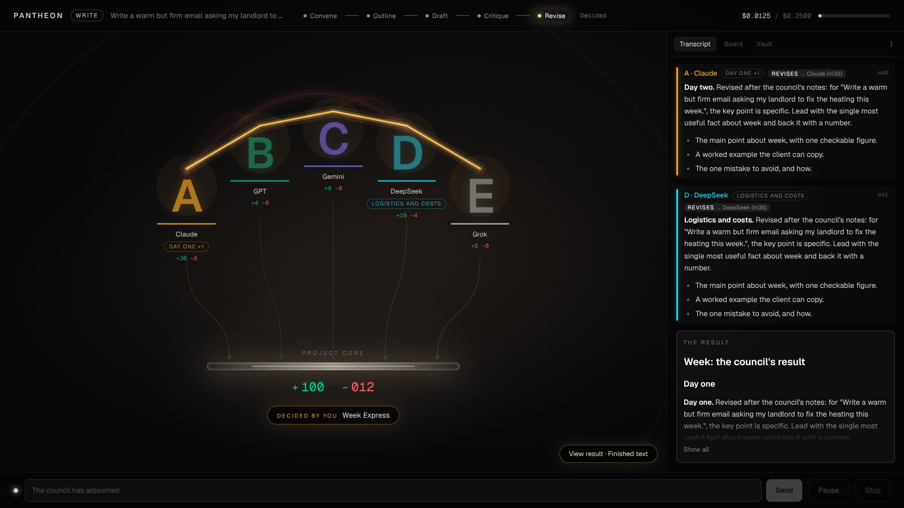
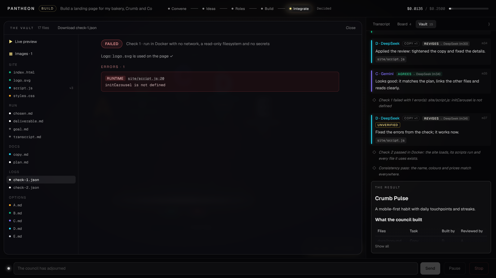

# Pantheon

A council of AI models from different providers takes on anything people use AI for (a question, an email, a trip, a decision, a topic to learn, a business idea), debates it, splits the work by vote and delivers the result while you watch. The full spec is in [`PANTHEON_SPEC.md`](PANTHEON_SPEC.md). "Pantheon" is a placeholder name; it lives in `backend/app/config.py` (`APP_NAME`) and `frontend/src/lib/app.ts`.

## Status

All seven milestones in the spec are built.

- Milestone 1 (Skeleton) is done: FastAPI, Next.js and SQLite, with one OpenRouter call going end to end.
- Milestone 2 (Debate engine) is done: seats debate a goal in the terminal with round limits, a majority vote, a moderator summary and a hard budget cap, and the transcript is saved.
- Milestone 3 (The Chamber, live) is done: convene a council in the browser and watch the debate play out live.
- Milestone 4 (Missions, voting and checkpoints) is done: Ask, Write, Plan, Decide and Learn run end to end, and Launch runs to its idea checkpoint. Options are scored anonymously, you pick at checkpoints and review the result, and you can address the council at any time.
- Milestone 5 (Roles and building) is done: Build produces a multi-file website, and Launch now goes through Research, Roles and Build to a site plus business documents. Workstream leads are voted in, you approve the task plan, builders work in parallel with reviews, and the Board and the Vault show it all, including a live preview of the site.
- Milestone 6 (Images and integration) is done: image consultants and the Create mission; Build and Launch now end with an Integrate phase that runs the site in a locked-down Docker container, sends errors back to their owners, makes sure the site uses its own logo and checks name, colours and prices for consistency. Claims of success without proof are marked unverified.
- Milestone 7 (Replay, Demo mode and deployment) is done: login with invite-only accounts, Replay with a scrubber at 1× to 8×, a recorded demo that plays with no API calls, and a Docker Compose deployment behind Caddy with automatic HTTPS (see [`docs/DEPLOY.md`](docs/DEPLOY.md)).

No seat has a fixed role. Later in a run, each model puts itself forward for the work it's best at and the council votes on who does what.




## Requirements

Python 3.12, [uv](https://docs.astral.sh/uv/), Node.js 20+ and an [OpenRouter](https://openrouter.ai) key. Set a spending limit on the key.

For the Integrate phase (Build and Launch), install [Docker](https://docs.docker.com/get-docker/) and build the runner image once:

```bash
docker build -t pantheon-runner:1 backend/runner
```

Without it, runs still finish, but the site is never run and anything that depends on that stays marked unverified.

Image keys are optional. Add any of `RECRAFT_API_KEY`, `OPENAI_API_KEY`, `GEMINI_API_KEY`, `BFL_API_KEY` (FLUX) or `SEEDREAM_API_KEY` to `.env`. With none, a free practice consultant draws simple SVG logos and banners on your machine.

## Run it

```bash
cp .env.example .env          # then fill in OPENROUTER_API_KEY, ADMIN_EMAIL and ADMIN_PASSWORD (10+ characters)

# Terminal 1: backend on :8000
cd backend
uv sync
uv run uvicorn app.main:app --reload --port 8000

# Terminal 2: frontend on :3000
cd frontend
npm install
npm run dev
```

Open http://localhost:3000 and log in with the `ADMIN_EMAIL` account (it is created on first start). Pick a mission (or leave it on Auto), write a goal, pick the seats, set a budget cap and press **Convene the council**. The Chamber opens and the run plays live. http://localhost:3000/test still sends a single test call.

### Missions

| Mission | For | Phases (you decide at the bold ones) |
|---|---|---|
| Ask | Questions, advice | Answer → Debate → Verdict |
| Write | Emails, essays, cover letters, posts | **Outline** → Draft → Critique → **Revise** |
| Plan | Trips, events, meals, workouts | **Options** → Detail → **Check** |
| Decide | Choosing between products or offers | Criteria → Research → Debate → **Recommendation** |
| Learn | Understanding a topic | **Approach** → Lesson → Quiz |
| Build | Websites and small web apps | **Ideas** → **Roles** → Build → Integrate → **Review** |
| Launch | A business from scratch | **Ideas** → Research → **Roles** → Build → Integrate → **Review**: a landing page, marketing copy, a launch plan, a business plan and pitch deck text |
| Create | Logos, illustrations, image sets | **Concepts** → Create → **Review** the gallery |

- **Auto:** the moderator reads the goal, picks the mission and says why.
- **Options:** every seat proposes 1 to 3 options, and the others score them 1 to 5 without knowing who wrote them. No seat scores its own. You pick from the top 3, or ask for another round.
- **No fixed roles:** the moderator splits the work into parts. Seats put themselves forward for parts, the others vote (never for themselves), and each winner writes its part. Each seat's badge shows the part it was voted into. If a seat's provider fails, its part goes to another seat.
- **Critique and revise:** reviewers have to point at a specific passage in someone else's part, and the owner revises.
- **Review:** you accept the result, or ask for changes and the council revises it. The result opens in the Chamber, with Copy and Download.
- **Address the council:** type into the bar at the bottom at any time. Every seat sees your message as a direct instruction from the client.
- **Health, legal and money questions:** the council says it isn't a professional and flags when you should see one.


### Building (Build and Launch)

- **Roles:** the moderator proposes workstreams (for example copy, page structure, styling and interactivity). Seats pitch for them, the others vote (never for themselves), and a tie goes to the moderator. The moderator turns the result into a task plan. Every task has an owner, a reviewer who is always a different model, its files and its dependencies.
- **Plan checkpoint:** you approve the plan and can change any owner or reviewer first. A task can't be reviewed by its own builder.
- **Build:** tasks run in waves that respect their dependencies, with up to 3 at once. Builders write real files under `projects/<run_id>/site/` and `docs/`. A builder may ask a teammate one question through the Board, and the moderator routes it. Each reviewer either approves or asks for specific changes (at most 2 rounds). If a seat's provider fails, its task moves to another seat.
- **Review:** you see the site itself in the review card. Asking for changes sends them to the tasks they affect.
- **The Board** shows every task by status, with owner, reviewer, files and any question thread. **The Vault** shows every file: code with line numbers, documents rendered, and a live preview of the site.
- **The preview is sandboxed.** It's served read-only by the backend with a strict content security policy (no network access, no forms sent anywhere) inside a sandboxed iframe, so the site's scripts can't reach the app or the internet. On the server, the site only ever runs inside the locked-down Docker container described below.
- **How models write files:** a builder's reply is the usual JSON, followed by plain `=== FILE: path ===` … `=== END FILE ===` blocks. Paths must stay under `site/` or `docs/`, only text file types are allowed, and there's a size limit.


### Images and integration

- **Image consultants:** Recraft (vector; the default for logos), OpenAI images, Gemini image, FLUX and Seedream. Each one is only available if its key is in `.env`, and the key goes only to that provider. A builder asks for an image in its reply and picks the consultant. If that one isn't connected, the moderator says so and another one makes it. Every image passes through the budget cap. Generated SVG is cleaned with an allowlist: no scripts, no event handlers, no outside links.
- **Create:** you pick a concept, seats are voted in as designers for each image, a different seat reviews each brief, a challenged image is regenerated once, and you review the gallery.
- **Integrate:** the site runs in Docker using `backend/runner/`, and every check run gets a fresh container:
  - no network
  - a read-only filesystem
  - only `site/` mounted, and read-only
  - no environment variables (so no secrets)
  - capped memory, CPU and processes
  - no Linux capabilities and a non-root user
  - a 30-second timeout

  The checker loads every page with jsdom, runs its scripts, and reports script errors, missing files, syntax errors and whether the logo is used. Each error goes to the owner of its file, and the check runs again (at most 2 fix loops). If no logo was made, the page's owner gets one made. A consistency pass then compares the name, colours and prices across the site and the documents. Check logs are kept in `logs/check-N.json` and shown in the Vault.
- **Fact-checking:** a message that claims success ("it works now", "tests pass") must list evidence (`"proposal": {"evidence": ["logs/check-2.json"]}`). A check log only counts if that check passed. Without valid evidence, the message shows an **Unverified** tag.




### Accounts

Nobody can sign up without an invite. The owner account comes from `ADMIN_EMAIL` and `ADMIN_PASSWORD` on first start. On the home page the owner presses **Invite someone** to get a one-use link that expires after `INVITE_DAYS`. Each person sees and controls only their own runs. You can also add accounts from the terminal: `cd backend && uv run python -m app.cli create-user friend@example.com` (add `--owner` for another owner).

### Replay and the demo

- **Replay:** every finished run has a **Replay** button (or open `/replay/<run_id>`). It plays the stored events through the same Chamber at 1×, 2×, 4× or 8×. Long waits are cut short. The scrubber shows each phase as a tick and each checkpoint as an amber dot. Drag it, or use the arrow keys and the space bar. Effects only fire while playing. **Clean** hides the transcript and the controls for filming. Checkpoint cards show what was asked but can't be answered.
- **Demo:** `demo/launch/` is a recorded Launch run with six seats. It covers the idea pick, research, role votes, the plan, a build whose first Docker check fails and is fixed, and the review. It was recorded with the practice council below, so its replies are scripted. It's imported as a public, read-only run on start, and anyone can watch it under **Watch a demo** without logging in. With `DEMO_MODE=true`, new runs are switched off and the home page only offers the demo. That's safe for a public link and needs no API key.
- Record your own: finish a run, then `cd backend && uv run python -m app.cli export-demo RUN_ID SLUG` writes `demo/SLUG/`.


### Deploy

See [`docs/DEPLOY.md`](docs/DEPLOY.md): a VPS with Docker Compose, Caddy for HTTPS, and `docker compose up -d --build`.

### Practice without spending anything

`backend/scripts/fake_openrouter.py` stands in for OpenRouter and streams scripted replies for every mission step (from `backend/app/devtools/council_script.py`). Use it to work on the UI or film the Chamber for free:

```bash
# Terminal 1: the practice server
cd backend && uv run python scripts/fake_openrouter.py          # --cps 80 types slower

# Terminal 2: the backend, pointed at it
cd backend && OPENROUTER_BASE_URL=http://127.0.0.1:9100/v1 OPENROUTER_API_KEY=fake \
  uv run uvicorn app.main:app --reload --port 8000

# Terminal 3: the frontend as usual
cd frontend && npm run dev
```

`--fail anthropic/claude-sonnet-4.5` makes that seat's provider fail, so you can see the absent state.

### The Chamber

- **Arc of seats:** each seat's letter in its colour on a pedestal. A seat dims when idle, shimmers while thinking, and grows with a caption bubble while speaking. A seat whose provider failed turns grey on a dashed pedestal.
- **Lines between seats:** white for a proposal, green for agreement, flickering red for a challenge, dotted for a question. A comet travels in the speaker's colour, and the line fades to a faint trail. Pairs that argue or agree build red or green haze between them. Hover a line to see the message it carried.
- **Project core:** every file a seat writes sends a pulse down its arrow into the core. The odometer counters show lines added and removed. Click the core for the live diff feed. The files are whatever the run writes in `projects/<run_id>/`: notes, documents and the site.
- **Top bar:** the phase rail and the cost meter, which turns amber at 80%. At the cap, the run pauses and a card asks you to raise it or stop.
- **Transcript drawer:** streams every message. It collapses for demos, and on phones it becomes a bottom sheet.
- **Pause and stop** take effect between turns. Reduced-motion settings swap the effects for simple fades.
- Opening a run's link later replays the whole meeting from the event log, then continues live.

## Run a debate in the terminal

```bash
cd backend
uv run python -m app.cli debate "Come up with a name and positioning for a coffee subscription startup" \
  --seats A,B,C,D --rounds 3 --budget 0.25
```

- Round 1: every seat proposes. Rounds 2 and 3: seats agree, challenge, propose or question. If every present seat agrees with the same proposal, the debate ends early.
- After the round limit, each seat votes for one proposal that isn't its own and the majority wins. The moderator (`MODERATOR_MODEL`) breaks ties and writes the summary.
- Each call's cost is estimated before it's sent, using OpenRouter's price list, and the real cost is recorded after. At 80% of the cap you get an amber warning. If a call would pass the cap, the run pauses and asks for a new cap, or stops if you press Enter.
- A seat whose provider fails shows as absent and the debate continues. An invalid reply is retried once with the error shown, then dropped.
- The transcript is saved to `projects/<run_id>/transcript.md` and `transcript.json`. Every step is also stored in the `events` table for the live Chamber and Replay later.
- For the cheapest test run, add `--model-override openai/gpt-4o-mini` so every seat uses one cheap model.

The model IDs in `config/seats.yaml` change often. Check them at https://openrouter.ai/models before a real run.

## Checks

```bash
cd backend && uv run pytest        # mocked gateway, no API cost; the `docker` tests use the runner image if it's built
cd backend && uv run ruff check .
cd frontend && npm run lint && npm run build
```

## Layout

```
backend/app/config.py      APP_NAME + settings from .env
backend/app/gateway/       OpenRouter client (OpenAI SDK)
backend/app/db/            SQLite tables: runs, seats, messages, votes, tasks, artifacts, events
backend/app/orchestrator/  missions, building (workstreams, plan, parallel build), debate rounds, voting, checkpoints, budget, reply and file-block formats, file sandbox
backend/app/events/        ordered event log + in-process bus for the WebSocket
backend/app/runs.py        starts runs in the background; pause, stop, budget answers
backend/app/auth.py        accounts, invites, login sessions, who can see and change a run
backend/app/demo.py        imports demo/ as public runs; exports a run as a demo
backend/app/cli.py         terminal entry point (debate, create-user, export-demo)
backend/scripts/           fake_openrouter.py practice server
frontend/                  Next.js app: convene, login, invites, Chamber, Replay
frontend/src/lib/chamber/  event reducer, layout geometry, WebSocket and Replay hooks
frontend/src/components/   Chamber (seats, core, PixiJS effects, transcript) and the convene form
config/seats.yaml          the 13 seats (check model IDs at openrouter.ai/models)
demo/                      recorded demo runs, played with no API calls
deploy/Caddyfile           HTTPS and routing for docker-compose.yml
projects/                  one folder per run (git-ignored)
```
